# Rabt (ربط)

**Getting recovered pilgrims from the hospital back to their accommodation, with one confirmed handoff.**

Team Tronx · MEDATHON 2026 (Saudi Youth Healthcare Forum, Jeddah) · Track 1: Crowd & Patient Flow · MED-5XWGZT

**Live prototype:** https://rabt-snowy.vercel.app/

## Try the guided demo

Open the prototype and choose **Start guided demo**. Use **Next** to follow Ahmad from the hospital desk to his accommodation, or select **Play** to watch the sequence. Look for the handoff where the nurse checks the driver's name and plate before Ahmad leaves. You can also explore the hospital, company, or driver view on your own.

The demo uses sample records, simulated SMS, and an in-app preview of the family status page. All roles share the same browser data so you can switch between them without signing in.

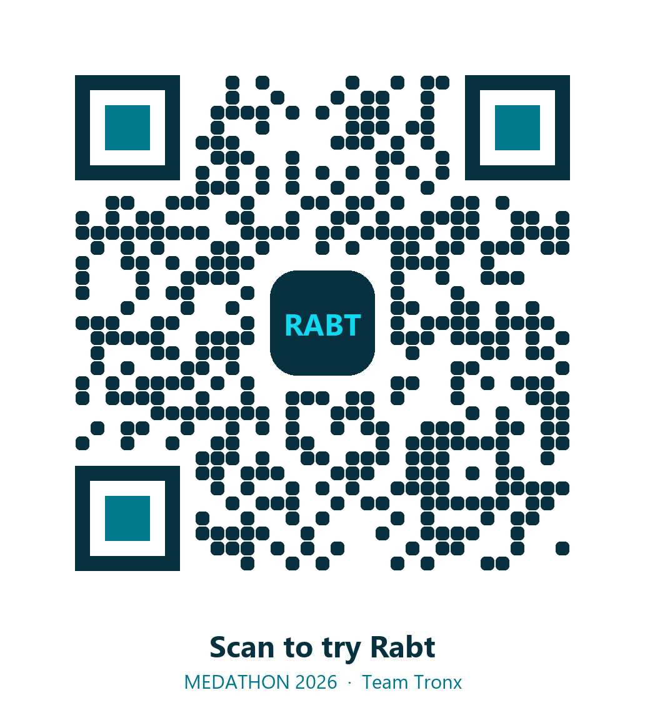

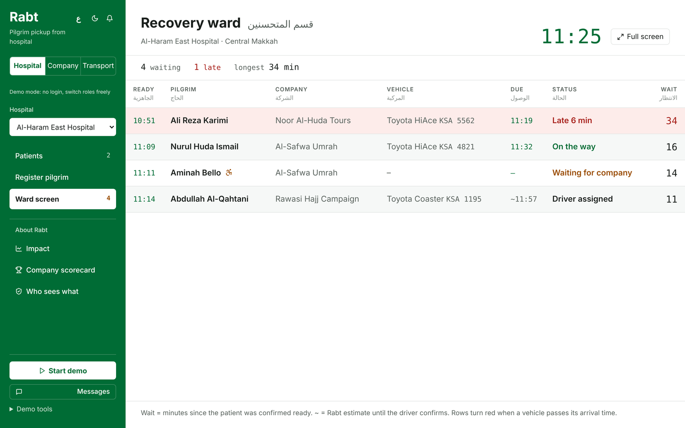

---

## The problem

When a Hajj or Umrah pilgrim is treated and ready to leave the hospital, someone has to take them back to their accommodation. That is the job of the company the pilgrim travelled with. Today, it usually goes like this:

1. The pilgrim is ready to leave, but no car is on the way and no one has given an arrival time. Often the company doesn't even know its pilgrim is in hospital.
2. The pilgrim waits in the recovery ward while new patients keep arriving.
3. Beds and staff are tied up by patients who no longer need them. Nurses spend their time phoning around to find the right company.
4. The ward gets crowded, and the hospital is held responsible for it.
5. Complaints are escalated to the Ministry, and companies face fines and suspensions.

This is a real and enforced obligation. In June 2025 the Ministry of Hajj and Umrah suspended seven Umrah companies for failing to provide the transport they had promised, and earlier rounds of fines reached up to SAR 50,000 per company. The flow of patients doesn't stop after Hajj either: in Ramadan 2026 alone, Ministry of Health hospitals recorded 109,793 emergency visits and 8,687 admissions.

## What Rabt does

Rabt connects the hospital with the company responsible for each pilgrim and tracks every step until the pilgrim is home.

| Step | Who | What happens |
|---|---|---|
| 1. Arrives | Hospital desk | Scans the Nusuk card or enters the Umrah booking number. Rabt identifies the responsible company and notifies it. |
| 2. Diagnosed | Doctor | Picks a condition group. Rabt suggests a ready time based on the typical stay for that condition; the doctor confirms or changes it. The company sees the time only, never the diagnosis. |
| 3. Ready | Nurse | Ticks a short checklist and marks the pilgrim *Ready for transport*. The company is alerted at once. |
| 4. Car sent | Company | Sends its nearest driver (with a travel-time estimate), or requests a ride from Rabt's licensed fleet partner. |
| 5. Handover | Nurse | Checks the driver's name and plate, then confirms the handover before the pilgrim leaves. |
| 6. Home | Driver | Confirms arrival. The case closes with a full timeline of every step. |

If the company doesn't respond, Rabt escalates automatically:

- **10 minutes:** a reminder goes to the company manager.
- **20 minutes:** a second contact at the company is alerted.
- **30 minutes:** Rabt offers a partner ride (pay per ride on the Basic plan).

If something goes wrong (a very late car, a wrong driver, nobody answering), the hospital uses **Report a problem**. The report goes to Rabt and the company, who must fix it within 30 minutes. It is handled between the two of them and is not sent to the Ministry.

The prototype previews the family's status page and the messages they would receive when the pilgrim is ready, when a car is on the way, and when the pilgrim arrives. Open **Messages** to see the simulated SMS.

Patients who need medical transport are not part of Rabt. The hospital decides, and the Red Crescent and 911 handle those cases as they do today.

## Who sees what

These are the intended access rules for a live rollout. The prototype illustrates them in each view using shared sample data.

| | Hospital | Company | Driver | Family |
|---|---|---|---|---|
| Name, booking number, accommodation | Yes | Yes | Pickup details only | First name and hospital only |
| Diagnosis and clinical notes | Yes | No | No | No |
| Expected ready time | Yes | Yes | No | No |
| Where the pilgrim is on the way home | Yes | Yes | Their own trips | Yes |
| Timeline of every action | Yes | Their own pilgrims | Their own trips | No |

## Screens

| Hospital: recording a diagnosis | Company: pickup requests and readiness |
|---|---|
| 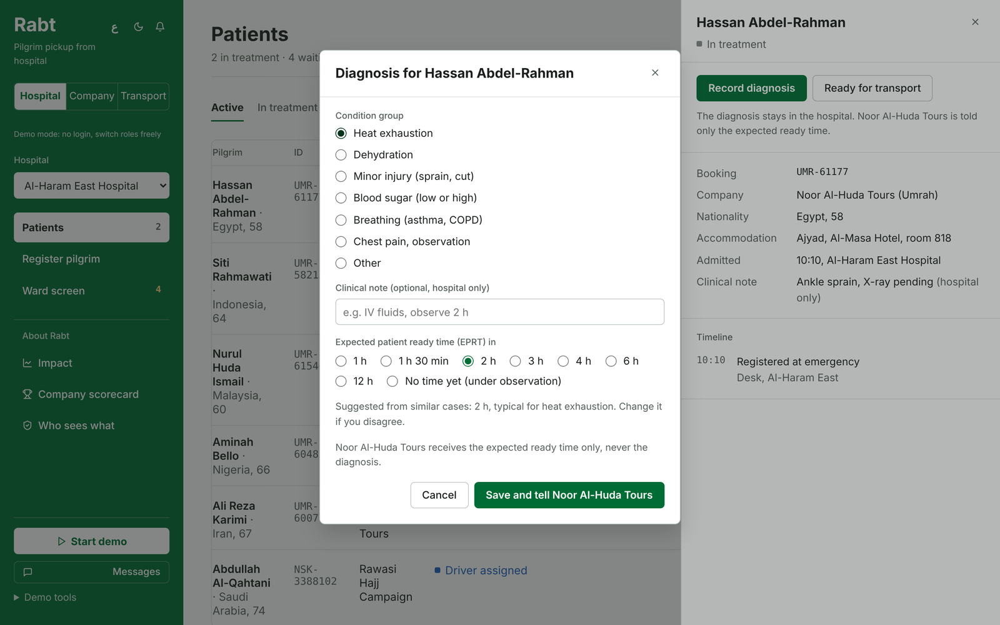 | 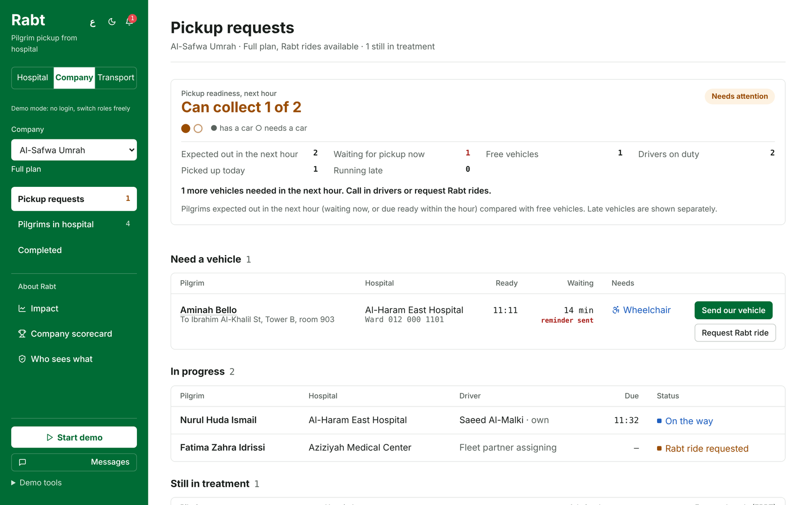 |

| Driver app | Company scorecard |
|---|---|
| 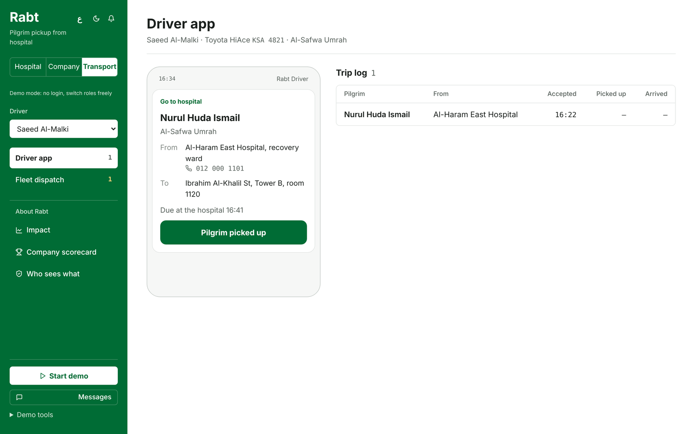 | 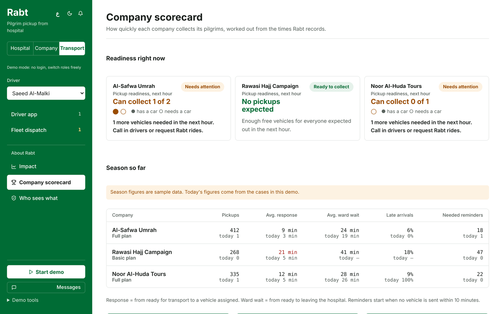 |

| Hospital: next 3 hours | What the family sees |
|---|---|
| 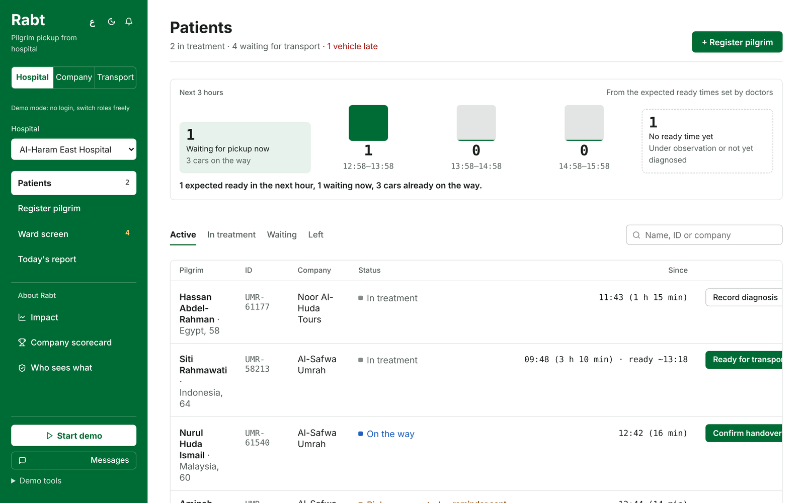 | 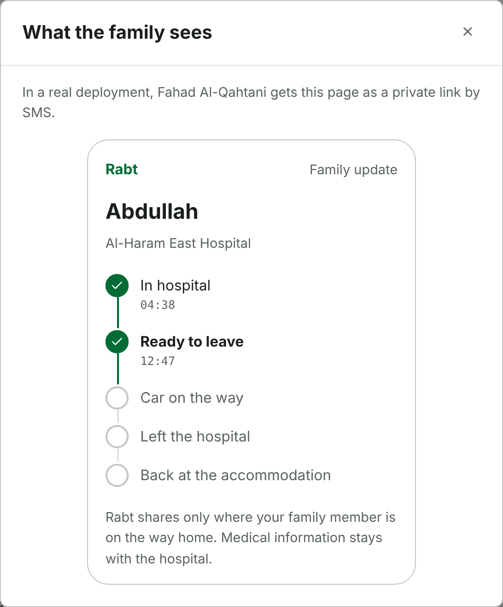 |

| Hospital: today's report | |
|---|---|
| 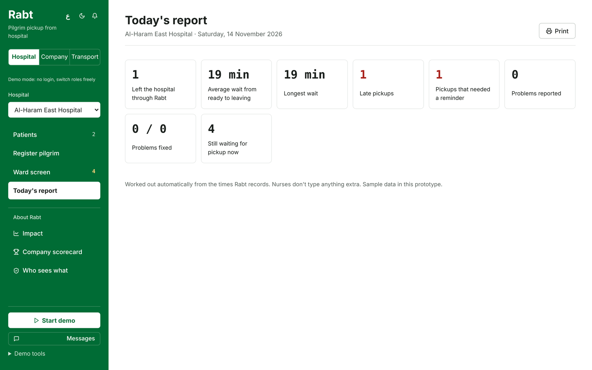 | |

| Arabic interface (default) | Guided demo on a phone |
|---|---|
| 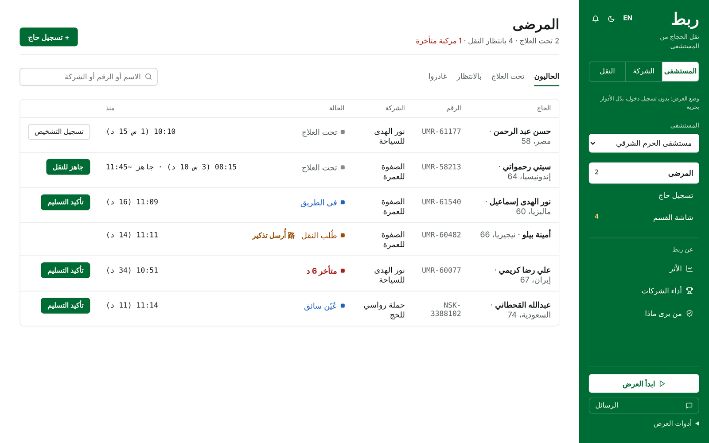 | 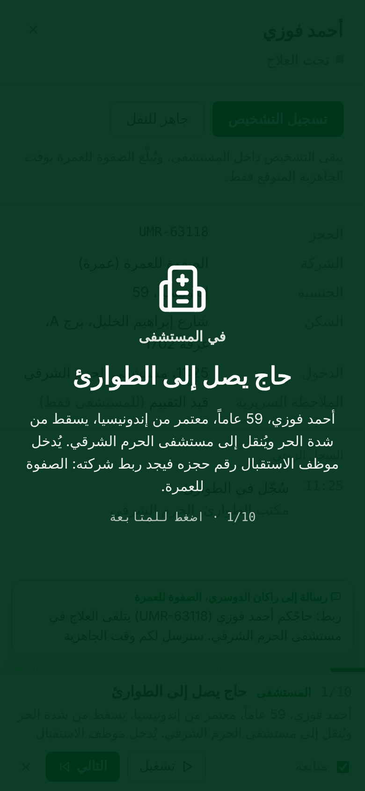 |

### Hospital
- **Patients:** everyone currently in the hospital, with a one-tap next step on each row (record diagnosis, ready for transport, confirm handover after checking the driver and plate).
- **Next 3 hours:** at the top of Patients, how many pilgrims are expected ready in each of the next three hours, how many are waiting now and how many cars are on the way, worked out from the ready times the doctors set.
- **Family contact and family view:** add or change the contact, and see exactly what the family sees.
- **Register pilgrim:** look up by Nusuk card or Umrah booking number. The family contact from the booking is filled in and can be changed.
- **Ward screen:** a board for the recovery ward showing who is waiting, which car is coming and who is late.
- **Today's report:** departures through Rabt, average and longest wait from ready to leaving, late pickups, reminders, and problems reported and fixed. Printable.

### Company
- **Pickup requests:** pilgrims ready to go, with a choice of driver sorted by travel time. For wheelchair users, accessible cars are listed first and choosing a car that isn't accessible shows a warning.
- **Readiness card:** how many of the pilgrims expected in the next hour the company has free cars for, shown as one dot per pilgrim.
- **Problems to fix:** reports from the hospital, with the time left to respond.
- **Pilgrims in hospital:** expected ready times, so the company can plan ahead.

### Transport
- **Driver app:** accept a trip with an arrival time, mark the pilgrim picked up, confirm arrival.
- **Fleet dispatch:** assign partner drivers to Rabt rides. Only accessible cars can be chosen for wheelchair users.

### About Rabt
- **Impact:** a simple simulator comparing a crowded ward today with the same ward using Rabt.
- **Company scorecard:** response time, ward wait, late arrivals and reminders per company, plus a chart of the busiest pickup hours so companies know when to keep a car free.
- **Who sees what:** the privacy rules above.

## Run it locally

You need Node.js 18 or newer.

```bash
npm install
npm run dev        # opens on http://localhost:5173
npm run build      # production build in dist/
```

`node scripts/build-standalone.mjs` builds the whole app into a single HTML file that opens without a server.

### Tests

```bash
npx playwright install chromium   # first time only
npm test
```

`tests/e2e.mjs` drives the real interface in a headless browser and checks the full ten-step demo plus the main scenarios: the company never receives the diagnosis, escalation at 10, 20 and 30 minutes, the handover check, the report-a-problem loop, family updates with no medical details, the 3-hour forecast, the busiest-hours chart, today's report, wheelchair matching, and the Arabic phone layout.

All data is sample data stored in the browser. Open tabs in the same browser stay in sync, so you can keep the hospital in one tab and the company in another. Use **Demo tools → Reset sample data** to start over.

## How it's built

- **React 18 + TypeScript**, bundled with **Vite**, hosted on **Vercel**.
- **Arabic first** (right-to-left), with an English switch. Light and dark themes.
- **No backend required for the demo.** State lives in the browser, so the prototype works offline and on any device.
- **Travel time** comes from a built-in estimate based on distance, with slower speeds near the Haram. The optional server function in `api/eta.js` can use Google Maps live traffic if a `GOOGLE_MAPS_KEY` environment variable is set on Vercel; without it, the app keeps using the built-in estimate.
- **Ready-time suggestion** uses the typical stay for each condition group (`src/stay.ts`, sample figures to be replaced with clinically reviewed ones). Every case records the estimate next to what actually happened, which is the data a learned model would be trained on later.

### Project structure

```
api/eta.js               Optional Vercel function for live travel times
docs/                    Screenshots and QR code used in this README
scripts/                 Single-file build
tests/e2e.mjs            End-to-end checks of the main scenarios
src/
  types.ts               Data model: hospitals, companies, drivers, pilgrims, pickups, complaints
  seed.ts                Sample data (all names are invented)
  store.tsx              App state and every action (register, diagnose, ready, assign, handover, ...)
  stay.ts                Typical stay per condition group
  eta.ts                 Travel-time estimate, plus the live-traffic client
  insights.ts            Scorecard, readiness, forecast, busiest hours, daily report, estimate vs actual
  i18n.tsx               Arabic and English text
  App.tsx                Layout, sidebar, notifications
  HospitalPortal.tsx     Patients, diagnosis, ready checklist, handover, ward screen
  CompanyPortal.tsx      Pickup requests, assigning a driver, problems to fix
  TransportPortal.tsx    Driver app and fleet dispatch
  Readiness.tsx          Company readiness card
  Forecast.tsx           Hospital: next 3 hours
  Family.tsx             Family contact and family status page
  Report.tsx             Hospital: today's report
  AboutPages.tsx         Impact, scorecard, privacy pages
  Demo.tsx               Guided demo and simulated SMS
```

### Status flow

```
in_treatment → ready → (ride_requested) → assigned → accepted → picked_up → arrived
                                                       └─ "late" when the promised arrival time passes
```

## What this prototype is not (yet)

- There is no login. Anyone can switch roles, so judges can try every side.
- Pilgrim and company lookups use sample data. A real deployment needs access to Nusuk card and booking records.
- Typical stays per condition are sample figures until reviewed by clinicians.
- SMS messages are shown on screen, not sent.

## Next steps

1. Pilot in one Makkah hospital with two Umrah companies and one licensed transport partner.
2. Compare minutes from *ready for transport* to *verified handoff* before and during the pilot.
3. Confirm the legal basis and consent under the Saudi Personal Data Protection Law (PDPL).
4. Replace sample stay times with real data from the pilot.

## Team Tronx

| Name | Role |
|---|---|
| Faisal Alhelali | Team lead, engineering and integration |
| Maya Faghia | Software and system design |
| Ghazal Arab | Data management and integration |
| Retal Abdulsalam | Cybersecurity and data privacy |
| Faisal Bahaij | Medical research and clinical validation |

## Sources

- [Ministry of Health: Ramadan 2026, 109,793 emergency visits and 8,687 admissions](https://www.moh.gov.sa/en/ministry/mediacenter/news/pages/news-2026-03-19-001.aspx)
- [Ministry of Health: Hajj 2026, 58,462 emergency cases and 8,342 admissions](https://www.moh.gov.sa/en/ministry/mediacenter/news/pages/news-2026-05-30-003.aspx)
- [GASTAT Hajj report 1447: 1,707,301 pilgrims](https://www.stats.gov.sa/documents/d/guest/hajj-report-1447h-en)
- [GASTAT via Argaam: 35.68 million Umrah performances in 2024](https://www.argaam.com/en/article/articledetail/id/1799151)
- [Arab News: seven Umrah companies suspended over transport violations, June 2025](https://www.arabnews.pk/node/2604802)
- [Khaleej Times: Umrah companies fined up to SAR 50,000](https://www.khaleejtimes.com/world/10-umrah-companies-fined-50000-riyals-in-saudi-arabia?amp=1)
- [Ministry of Hajj and Umrah: Nusuk Masar and the Nusuk card in 2025](https://haj.gov.sa/en/Media-Center/Ministry-News/2026/Ministry-of-Hajj-and-Umrah-Highlights-Its-Key-Efforts-in-Serving-Pilgrims-During-2025)
- [Khaleej Times: Umrah visas require hotels and transport booked in advance](https://www.khaleejtimes.com/uae/umrah-pilgrims-visa-pre-book-hotels-transport-saudi)
- [Ministry of Health: King Abdullah Medical City discharge section](https://www.moh.gov.sa/en/ministry/mediacenter/news/pages/news-2015-09-21-002.aspx)
